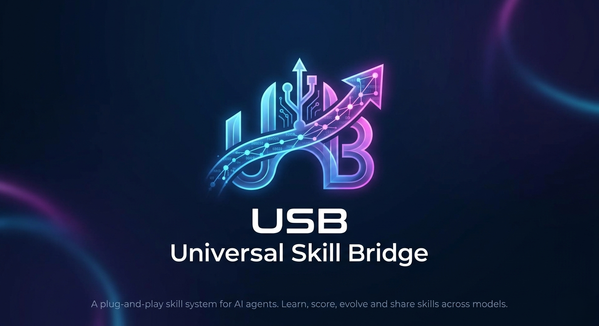
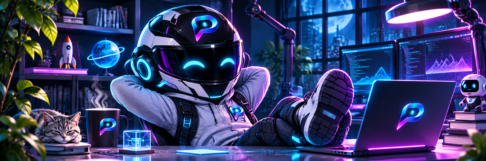
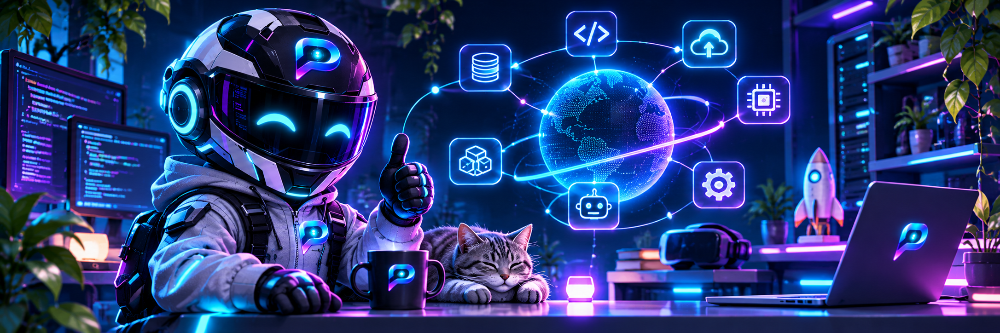
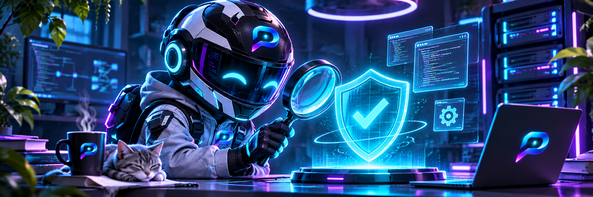

&#x20;

 

 

\# Peepsick Labs

\*\*We build the infrastructure. Agents do the work.\*\*

AI Infrastructure · Agent Systems · Developer Tools · Autonomous Software

PEEPSICK LIMITED · London, United Kingdom · Independently funded · Building in public

 

\[Website](https://peepsicklabs.com) · \[GitHub](https://github.com/PeepSick) · \[Contact](mailto:info@peepsicklabs.com)

\---

\## Ⅰ. About Us

Peepsick Labs is an independent software company focused on AI infrastructure, agent systems, developer tools and autonomous software.

We design and build practical systems that help AI agents discover capabilities, interact with software, work across environments and get things done.

Our work spans open-source infrastructure, independent software products and connected AI ecosystems.

We believe in useful engineering, portable systems and products that solve real problems.

\---

\## Ⅱ. Our Ecosystem

A growing collection of products and technologies, each designed to solve a different part of the AI infrastructure puzzle.

| Project | Description | Status |

| :--- | :--- | :--- |

| 🛸 \*\*\[USB+ — Universal Systems Bridge](https://usb.peepsicklabs.com)\*\* | An open-source bridge for discovering, installing and verifying AI skills across agent runtimes. Includes secscan, mcprobe, SHA-256 integrity verification, lock, diff and repair. 529 skills and 16 runtime targets. | 🟢 Live · v1.1.0 |

| 🔍 \*\*\[IzMercek](https://izmercek.com)\*\* | AI Visibility Intelligence Platform. Helping businesses understand how their websites and brands appear across AI-powered search and answer experiences. | 🟢 Live |

| 🧠 \*\*LeoSIS Ecosystem\*\* | An AI agent ecosystem built around the LeoSIS runtime, autonomous workflows, multi-agent orchestration, persistent context and integrations. | 🔵 Coming soon |

| 🎙️ \*\*\[ModelForce](https://github.com/PeepSick/ModelForce)\*\* | Self-hosted voice infrastructure with a unified interface for multiple TTS providers, including Piper, Kokoro and XTTS. | 🛠️ Active development |

| 📬 \*\*Keep E Box\*\* | An agent-native, provider-agnostic mail workspace connecting major mail providers through a unified model, agent layer, policy engine and SDK. | 🧪 Internal development |

| 🏭 \*\*FinishOps\*\* | Release operations console for repository auditing, release readiness, Definition of Done, technical debt and release workflows. | 🧪 Internal development |

> \*\*USB+ connects capabilities. IzMercek measures AI visibility. LeoSIS powers intelligent agents. ModelForce gives AI a voice. Keep E Box connects agents to communication. FinishOps helps teams ship.\*\*

\---

\## Ⅲ. USB+ — Universal Systems Bridge

One bridge for AI capabilities, runtimes and trust.

USB+ started with a simple idea: AI skills and capabilities should be portable across runtimes, easy to discover and easier to verify.

It has evolved into an open-source ecosystem combining capability discovery, installation and a dedicated trust layer.

\*\*The Trust Layer:\*\*

\- `secscan` — Static skill contract verification with file and line-level evidence.

\- `mcprobe` — Consent-based runtime observation of MCP servers.

\- `verify` — SHA-256 integrity checks for installed skills.

\- `lock` — Reproducible, version-pinned installations.

\- `diff` — Capability and permission change inspection.

\- `repair` — Restore verified installed files.

\- GitHub Code Scanning support through SARIF output.

\*\*Current release:\*\* v1.1.0

\*\*License:\*\* MIT

\[Explore USB+](https://usb.peepsicklabs.com) · \[GitHub Repository](https://github.com/PeepSick/usbplus) · \[npm CLI](https://www.npmjs.com/package/@peepsick/usb-cli) · \[npm SDK](https://www.npmjs.com/package/@peepsick/usb-sdk)

\---

\## Ⅳ. LeoSIS — Agent Ecosystem

LeoSIS is part of the core Peepsick technology ecosystem.

It is not just another chatbot. The project explores autonomous agent execution, computer interaction, multi-agent collaboration, persistent context and connected tools.

The LeoSIS ecosystem is designed around modular capabilities and a runtime that can bring different models, tools and workflows together.

Its development includes:

\- Autonomous agent runtime

\- Computer interaction and automation

\- Multi-agent orchestration

\- Persistent sessions and context

\- Voice interaction

\- Tool and MCP integrations

\- Business and workflow intelligence

Public release and product details will be announced separately.

\---

\## Ⅴ. How We Work

\- \*\*Build in public.\*\* We share useful tools, experiments and selected parts of our development process.

\- \*\*Honest engineering.\*\* Released products, active development and upcoming projects are clearly distinguished.

\- \*\*Open source where it makes sense.\*\* We publish useful infrastructure and developer tools whenever practical.

\- \*\*Portable by design.\*\* We avoid unnecessary dependence on a single provider, framework or runtime.

\- \*\*Small teams, real products.\*\* We focus on shipping useful systems rather than adding complexity for its own sake.

\---

\## Ⅵ. Technology

\---

\## Ⅶ. GitHub Activity

\---

\## Ⅷ. Open Source \& Collaboration

We enjoy working with people who build things, challenge assumptions and contribute practical ideas.

Bug reports, documentation improvements, new runtime adapters, security research and meaningful pull requests are welcome.

Explore our repositories and build something with us.

  

\### Built with curiosity at Peepsick Labs.

\*\*Independent software. Connected intelligence. Useful technology.\*\*

 

🌐 \[peepsicklabs.com](https://peepsicklabs.com) ·

🛸 \[USB+](https://usb.peepsicklabs.com) ·

🔍 \[IzMercek](https://izmercek.com) ·

✉️ \[info@peepsicklabs.com](mailto:info@peepsicklabs.com)

PEEPSICK LIMITED · London, United Kingdom

